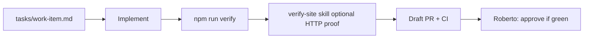

# Agent-friendliness plan (robansuini.github.io)

**Status:** Draft — inverse-pyramid priorities for making this repo safe for autonomous agents without increasing human review load.

**Inspired by:** [poteto on agent-ready repos](https://x.com/poteto/status/2111133080526495985) and the [pstack](https://github.com/cursor/plugins/tree/main/pstack) workflow (`poteto-mode`, verification skills, prove-before-merge).

---

## 1. Evidence: how Roberto reviews (GitHub)

**Data source:** All 33 pull requests on `robansuini/robansuini.github.io` (Oct 2026), GraphQL review bodies and merge history.

Roberto (`robansuini`) rarely leaves inline review comments on agent PRs. Feedback is almost entirely **merge gating via automated checks**, with short approval notes when integrating **stacked PRs**:

| Pattern | Example review body |
|--------|---------------------|
| Stack integration | “Reviewed in the combined PR integration stack; the site link scan and regression suite pass with this change.” |
| Post-rebase | “Reviewed after resolving the file-discovery stack conflict; the link scan and all 22 regression tests pass.” |
| Silent approve | Empty body + `APPROVED` (common on smaller UX/content PRs) |

**Implied review bar (inferred, not written as policy):**

1. `node scripts/check-external-links.js` must pass.
2. `node --test scripts/check-external-links.test.js` must pass (count (28 as of Oct 2026)).
3. Stacked branches must be rebased without breaking the above.
4. Human judgment on copy/brand is light-touch once CI is green.

**Takeaway for agents:** Roberto’s “review” is **verification-first**. Agents should ship PRs that **prove** safety (test output in PR body or CI), not essays. Prose AGENTS.md is lowest priority; executable contracts matter most.

---

## 2. Evidence: common agent pitfalls (git history)

**Repo shape:** Single-page static site (`index.html`) + Node checkers under `scripts/` + GitHub Actions `site-checks`. No bundler, no TypeScript.

| Pitfall | Symptoms in this repo | Frequency signal |
|--------|------------------------|------------------|
| **Naive HTML/regex** | Chained fixes: attribute boundaries (#21), quoted `>` in attrs (#30), HTML comments (#19), single-quoted attrs (#27) | 8+ commits / 10+ PRs on link checker alone |
| **Stacked PR merge pain** | `Merge remote-tracking branch 'origin/master' into resolve-pr-*` | **6** such merge commits on `master` |
| **Duplicate parallel work** | PR #15 `fix: add sitemap.xml` closed; #17 merged | Overlapping agent branches |
| **Security defaults** | `target="_blank"` without `rel=noopener noreferrer`; newsletter CTA navigation (#25) | Fixed after checker existed |
| **A11y discovered late** | Social `aria-label` (#16, #20), focus ring (#28), `prefers-reduced-motion` (#29) | UX fixes after infra PRs |
| **Checker/HTML drift** | Canonical URL required in tests (#33) while checker name still says “external links” | Naming/boundary smell |
| **Over-fragmentation** | Many one-function refactors (#12–#18) before behavior stabilized | Hard for agents to pick “one PR” scope |

**Root cause:** Agents optimize for **small diffs** and **grep-friendly fixes** on a **hand-rolled HTML parser** without a single **verify** entrypoint or **work-item contract** at the time work started. The repo has since gained `tasks/work-item.md` (canonical URL) — that pattern should become default.

---

## 3. Inverse-pyramid roadmap

Higher items unlock cheaper automation below. Do not lead with long AGENTS.md.

```
                    ┌─────────────────────┐
                    │ 5. Human review     │  Roberto: CI green + minimal stack pain
                    └──────────┬──────────┘
                    ┌──────────▼──────────┐
                    │ 4. AGENTS.md (thin)   │  Pointers only: verify, tasks/, boundaries
                    └──────────┬──────────┘
                    ┌──────────▼──────────┐
                    │ 3. Lint / test / CI │  npm run verify, eslint on scripts, CI uses it
                    └──────────┬──────────┘
                    ┌──────────▼──────────┐
                    │ 2. Types / exports  │  Explicit module.exports; shared html-utils
                    └──────────┬──────────┘
                    ┌──────────▼──────────┐
                    │ 1. Structure        │  scripts/site-checks/*, tasks/, feature map
                    └─────────────────────┘
```

### Phase 1 — Structure & boundaries (highest leverage)

**Goal:** One obvious place per concern; agents copy patterns instead of inventing regex.

| Action | Rationale | Prototype in repo |
|--------|-----------|-------------------|
| **Rename / split checkers** | `check-external-links.js` now also asserts canonical URL in tests — misleading name causes wrong edits | Keep file for now; add `scripts/site-checks/README.md` index listing each invariant and its test name |
| **Extract shared HTML primitives** | Duplicate `getAttributeValue` in tests vs checker | New `scripts/lib/html-attributes.js` exported functions; checker + tests import same implementation |
| **Work-item template** | `tasks/work-item.md` already defines goal, acceptance criteria, validation commands | Add `tasks/TEMPLATE.md`; agent PRs link `tasks/<slug>.md` |
| **Freeze parser strategy** | No DOM dependency today (intentional for zero install) | Document in `scripts/site-checks/README.md`: “no cheerio/jsdom unless we add package.json policy” |

**Open question (answered by prototype):** *Should canonical checks live in a separate script?*  
**Answer:** Not yet. Test count is 26; splitting files before `npm run verify` exists adds agent navigation cost. Revisit when a third invariant class appears (e.g. sitemap XML schema).

### Phase 2 — Types, exports, module boundaries

**Goal:** Agents see **importable units** with stable names.

| Action | Notes |
|--------|--------|
| Export all checker helpers from one barrel | `scripts/site-checks/index.js` re-exports `run`, `findAnchorTags`, etc. |
| JSDoc on public functions | `@param` / `@returns` on `run`, `checkHtmlFile` — types without TypeScript build |
| Avoid test-only parsers | Tests should import `getAttributeValue` from lib once extracted |

### Phase 3 — Lint, tests, CI

**Goal:** One command reproduces Roberto’s bar.

| Action | Status |
|--------|--------|
| `package.json` scripts: `verify` = link check + tests | **Shipped in draft PR** `cursor/verification-skill-b1a3` |
| CI calls `npm run verify` instead of two steps | Follow-up (reduces drift) |
| ESLint on `scripts/**/*.js` | **Shipped in draft PR** `cursor/eslint-scripts-b1a3` |
| Optional: `html-validate` on `index.html` | Defer — adds dependency; hand checker is battle-tested here |

### Phase 4 — Minimal AGENTS.md

Keep under ~40 lines:

- Run `npm run verify` before every PR.
- Read `tasks/` for scoped work; do not stack unrelated PRs on `master`.
- HTML invariants: blank targets, canonical, a11y patterns documented in feature map.
- Link to `.cursor/skills/verify-site/SKILL.md` for driving the local server.

### Phase 5 — Human review

No process change required if phases 1–3 hold. PR body should include one line: **pstack interrogate + blast-radius** summary (see companion PRs).

---

## 4. Agent operating model (target)



**Parallelism rule:** One work item → one branch → one PR. Do not open sitemap + link checker + copy in parallel stacks (historical pain).

---

## 5. Verification skill (delivered separately)

Project-local skill: `.cursor/skills/verify-site/` — launch static server, doctor port ownership, drive homepage via HTTP + run Node tests, capture logs under `/tmp/verify-site-$RUN_ID/`.

Agents prove work the same way Roberto implicitly requires.

---

## 6. Metrics (baseline → target)

| Metric | Baseline (Oct 2026) | Target |
|--------|---------------------|--------|
| Commands to reproduce CI locally | 2 | **1** (`npm run verify`) |
| Merge commits for `resolve-pr-*` | 6 on recent history | **0** (single-branch policy) |
| Closed duplicate PRs | #15 vs #17 sitemap | **0** (work-item claim) |
| Regression tests | 26 | Grow only with new invariants |
| Inline human review comments | ~0 | Stay ~0; invest in tests |

---

## 7. Suggested implementation order (PR stack)

1. **This document** — align on priorities.
2. **Verification skill + `package.json`** — agents can prove behavior.
3. **ESLint on scripts** — catch footguns before review.
4. **Extract `html-attributes` lib** — stop duplicate parsers (small refactor PR).
5. **CI `npm run verify`** — single source of truth.
6. **Thin AGENTS.md** — after commands exist.

---

## 8. Architect synthesis (shape before more code)

**Chosen shape:** Keep zero-runtime-dependency static site; strengthen **Node checkers as the “type system”** for HTML invariants; add **orchestration** (`npm run verify`, verification skill) before more checker files.

**Rejected for now:**

- Full TypeScript migration — cost > benefit for ~300 lines of scripts.
- Playwright for homepage — useful later; `curl` + tests sufficient for single page.
- Monolithic `AGENTS.md` policy doc — contradicted by Roberto’s CI-only review style.

**Scrap signals (revisit if seen again):**

- New regex for HTML without a regression test in `check-external-links.test.js`.
- Third merge conflict resolution on a stacked agent branch in one week.

---

## Appendix A — Commands reference

```bash
npm run verify          # link safety + regression tests (after verification PR merges)
node scripts/check-external-links.js
node --test scripts/check-external-links.test.js
python3 -m http.server 8000   # manual preview
```

## Appendix B — Related draft PRs

- Plan: https://github.com/robansuini/robansuini.github.io/pull/34
- Verification skill + npm scripts: https://github.com/robansuini/robansuini.github.io/pull/35
- ESLint: https://github.com/robansuini/robansuini.github.io/pull/36

Merge order suggestion: **#35** (verify entrypoint + skill) then **#36** (lint; rebase to add lint into shared `package.json`), or squash both tooling PRs if conflict-prone.
